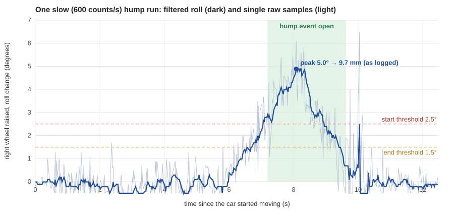

# Terrain analysis report: IMU hump detection, height measurement and motion monitoring

Buddy 4 deliverable. Covers the GY-511 accelerometer work on the AAI10 car up to 17 November 2026.

## 1. Summary

The car detects a speed hump from the sideways tip it causes and estimates its height in
millimetres. At the line-following speed (600 counts/s, about 50 mm/s) it detected the test hump in
15 of 15 runs, with no missed and no false humps. In the last ten runs, with the final calibration,
the height read 9.2 to 10.2 mm for a hump of 10 mm (mean 9.70 mm, standard deviation 0.33 mm).

| Requirement (project write-up) | Status |
| --- | --- |
| Calibrate the IMU | Done: automatic at power-up, repeatable with GP21 |
| Tilt detection | Done: pitch and roll from gravity, plus a tilt alert (section 6) |
| Hump detection | Done and tested on the car (sections 4 and 7) |
| Peak hump measurement | Done: height of every hump and the highest one of the run |
| Motion classification | Done: replayed on logged runs and checked on the car (section 8) |
| Turn-rate monitoring | Done, from the wheel encoders (the GY-511 has no gyroscope); checked on the car |
| Motion event reporting | Serial log and dashboard; MQTT reporting is the integration step (section 9) |
| Collision detection | Removed from scope by the team |

*Figure 1. One run at 600 counts/s. Dark line: filtered roll. Light line: single samples. The green
band is the time the detector held the hump event open.*

## 2. Hardware and sampling

- GY-511 module (LSM303DLHC accelerometer) on I2C0 at 100 kHz, address 0x19, SDA GP4 and SCL GP5.
- Accelerometer set to 100 Hz output, plus or minus 2 g, high-resolution 12-bit mode. One gravity
  is about 1000 counts.
- The firmware reads a sample every 20 ms. The ultrasonic read blocks the main loop for about 40 ms
  every fifth sample, so the real rate is about 35 samples per second (saved traces show 21 ms
  steps with a 60 ms gap every fifth sample).
- Each reading is the average of the last 8 samples (about 230 ms of data) before angles are taken.
- Pitch is `atan2(y, sqrt(x² + z²))` and roll is `atan2(x, sqrt(y² + z²))`, both relative to the level
  calibration. A raised right wheel reads as negative roll.

## 3. Calibration

At power-up, and whenever GP21 is pressed with the car stopped, the car averages 200 samples over
about 2 s in two halves. It rejects the calibration if the two halves differ by more than 1.5° of
pitch or 50 counts of magnitude, or if the gravity magnitude is outside 700 to 1500 counts. The
accepted values are the car's level reference.

If the accelerometer is missing at power-up the car now says so, re-probes it on GP21 and shows
`SENSOR_NOT_FOUND` or `NOT_CALIBRATED` on the dashboard. This was added after five runs on
17 November produced no terrain data at all because the one start-up probe had failed silently.

The hump detector also keeps its own baseline. The level reference moved by up to 0.7° between
floor spots, which alone would cost about 1.4 mm of height. At each run start the baseline is reset
to the level reference and converges quickly during the 3 s stationary countdown, then follows very
slowly and only while the signal is within 1.5° of it, so it cannot absorb a hump or a slope.

## 4. Why roll, and the detection algorithm

The test hump is 194 mm long (94 mm up, 6.5 mm plateau, 94 mm down), 10 mm high and 50 mm wide.
It sits under the right drive wheel only, because the barcode scanner blocks the left side. A 10 mm
lift on one wheel tips the car sideways by about 4.6° (about 0.5° per millimetre) but pitches it by
only about 3.5°. The original pitch-based detector has a 5° threshold and never fired on this hump,
so detection uses roll.

The detector is a small state machine in `hump_roll.h`:

| Rule | Value |
| --- | --- |
| Event starts when the roll change stays beyond | 2.5° for 120 ms |
| Event ends when it stays under | 1.5° for 200 ms |
| Shortest event counted as a hump | 350 ms |
| Longest event before it is cancelled | 10 s |
| Side | Only right-wheel-raised events count; left-side tips are logged and ignored |
| Launch hold-off | Roll ignored for 600 ms after the motors start (acceleration reads as roll) |
| End of run | An event still open when sampling stops is reported, not dropped |

The right-side rule exists because the car sways by 2° to 4° while driving and the accelerometer
cannot separate that from tilt. Before the rule, 5 of 9 flat-floor runs raised a false hump on the
left, with 4° to 6° peaks (8 to 12 mm). Since the rule, none of 13 flat-floor runs counted a false hump.
The sway is lopsided: it reached +4.7° to the left but only about -2.6° to the right at high speed,
and about ±1° at 600 counts/s.

## 5. Height estimation

Height comes from the largest roll of the event, using a table measured on the car with the right
wheel on flat stacks of paper:

| Lift (mm) | 0 | 10 | 15 | 20 |
| --- | --- | --- | --- | --- |
| Measured roll (°) | 0 | 4.62 | 7.49 | 10.16 |
| Ideal geometry, 110 mm track (°) | 0 | 5.18 | 7.73 | 10.23 |

The real car reads lower than the ideal geometry at small heights (tyre sag), so the firmware
interpolates the measured points and continues with the last slope beyond 20 mm. A scale factor then
corrects for how the car moves over a real hump, which reads higher than the stationary stacks.
The factor depends on speed, so it is only valid at the speed it was set at:

| Crossing speed | Unscaled reading for a 10 mm hump | Scale used |
| --- | --- | --- |
| About 2900 counts/s (240 mm/s), fast test move | About 12.6 mm (14 runs, 26% high), scatter 6 to 16 mm | 0.80, not reliable |
| 600 counts/s (49 mm/s), line-following cruise | About 11.0 mm (10% high) | 0.91 |

**The hump is therefore measured at 600 counts/s**, the line-following base cruise speed. In plain
course mode the car already holds that speed.

## 6. Tilt alert

Separately from humps, the car raises an alert when the combined tilt, `sqrt(pitch² + roll²)`, stays
above 15° for 400 ms, and clears it below 10° for 300 ms. A 10 mm hump at course speed tips the car
4.7° to 5.5° sideways and under 4° in pitch, flat-floor sway is about 1°, and a 20 mm hump (the top
of the measured table) reads about 11° combined, so the alert never fires on a hump or normal
driving. It ignores launch and turn moments. In a hand tilt test on 17 November (with the earlier
12° level) the alert fired twice and the maximum tilt shown was 27.1°. The 15° level was set
afterwards, and the team then confirmed on the car that the tilt alert, hump runs, turns and line
following behave correctly (a pass/fail check without recorded measurements).

## 7. Results

Unless stated, runs are from 17 November 2026: slow 50 cm move (about 12 s), hump foot 250 mm from the start.

| Test | Runs | Result |
| --- | --- | --- |
| Flat floor, 600 counts/s | 3 | No events, sway about ±1° |
| Flat floor, fast, right-side rule active | 5 | No hump; one left-side tip (4.7°, 678 ms) ignored |
| Flat floor, 14 November, right-side rule active | 5 | No false hump |
| Hump at 600 counts/s, first scale (0.80) | 5 | 8.2 to 9.3 mm, mean 8.8 mm, so the scale was raised |
| Hump at 600 counts/s, scale 0.91 | 10 | 9.2 to 10.2 mm, mean 9.70 mm, sd 0.33 mm |
| Hump, fast move (about 2900 counts/s), later runs | 11 | 6.4 to 15.8 mm: not usable |

Every run at 600 counts/s detected exactly one hump (15 of 15). Event duration was 1.9 to 2.5 s.
Heights at other speeds scatter by several millimetres (earlier fast runs also included one hump split
into two events and one missed hump), which is why the speed is fixed.

## 8. Motion classification and turn rate

`motion_class.h` classifies the car as stationary, accelerating, cruising, decelerating, turning,
climbing a hump or descending a hump. The GY-511 has no gyroscope, so speed and turn rate come from
the wheel encoders: speed is the mean wheel speed (12.13 counts per mm) and turn rate is
`(vR - vL) / 115 mm`, positive for a left turn. Hump phases follow the roll detector: climbing while
the roll rises, descending once it falls 1.5° below its peak.

| Rule | Value |
| --- | --- |
| Moving / stopped | Above 15 mm/s / below 8 mm/s |
| Accelerating or decelerating | Speed change beyond 12 mm/s² over 0.3 to 0.8 s |
| Turning | Above 20°/s until under 12°/s |
| A state change takes effect after it has held for | 300 ms |

These limits come from the 600 counts/s runs: the speed controller wobbles by about ±100 counts/s
at cruise, the launch ramp takes about 1.5 s to reach cruise, line steering gives under about
10°/s and a pivot turn gives about 30°/s. A host test (`tools/test_motion_class.py`) drives the
classifier with synthetic launches, wobble, steering, pivots and humps and replays the five saved
slow hump runs; all pass. The team also checked it on the car on 17 November (hump phases, a turn and
line following) with no problems reported; no measurements were recorded for that check.

## 9. Limitations and next steps

- Tested on one hump, 10 mm high, under the right wheel, at 600 counts/s. Taller humps use the
  measured table (10, 15, 20 mm) but were not driven; a hump spanning both wheels would barely tip
  the car sideways, so the roll detector could miss it.
- Obstacle mode may ramp line following up to 1000 counts/s on clear straights; the height scale is
  only verified at 600 counts/s.
- The car check of the tilt level and the motion-classification limits was pass/fail only; a
  recorded run with logs would make better evidence for the report.
- Hump height and events are not yet published over MQTT. Telemetry carries roll and hump height
  records on a separate branch (`rtos-terrain-telemetry`) that still needs this firmware connected
  to its terrain reader and a build on the ARM toolchain for the RTOS image.
- Not yet done by design, until all subsystems work together: the C host tests, the Barr C coding
  standard check and the minimum-bit representation of the terrain data.

## 10. Reproducing the results

- Flash `build/motion-wireless/robot_firmware.uf2`, press GP21 with the car flat and still, choose
  **50 cm forward SLOW (hump at course speed)** on the dashboard and press GP20.
- The dashboard Hump board and the `[HUMP]` log line give the height; `[MOTION STATE]` and
  `[TILT ALERT]` lines give the other events.
- Host tests: `python tools/test_hump_roll.py`, `python tools/test_tilt_alert.py` and
  `python tools/test_motion_class.py`.
- Details and parameters: `docs/testing/hump-roll-detector.md`.
